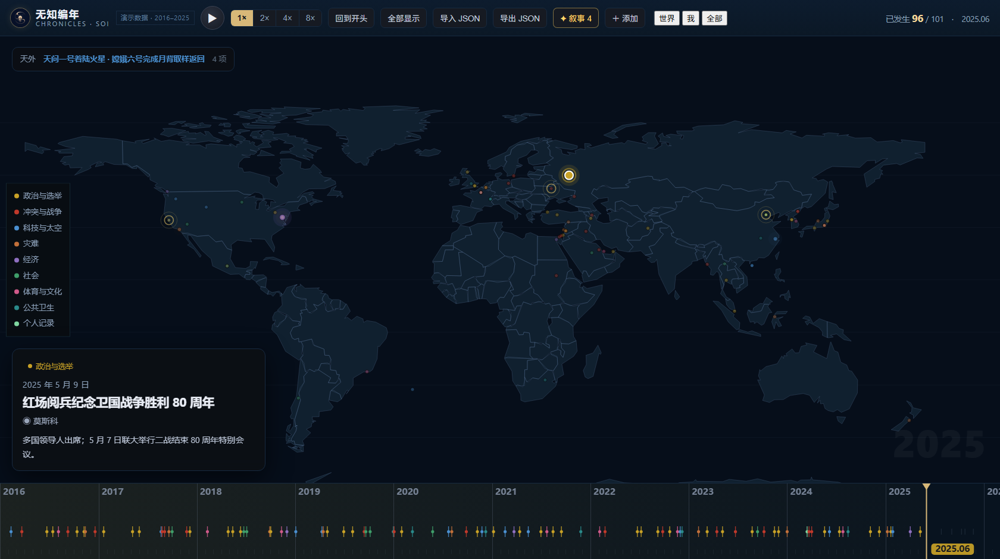
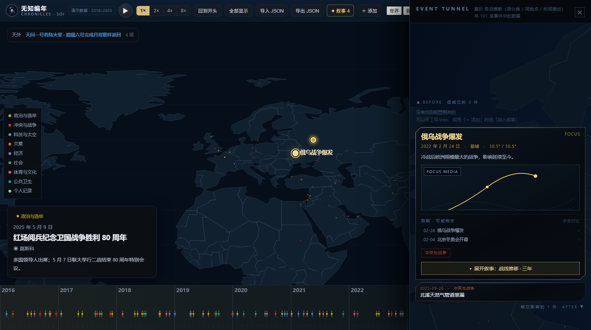
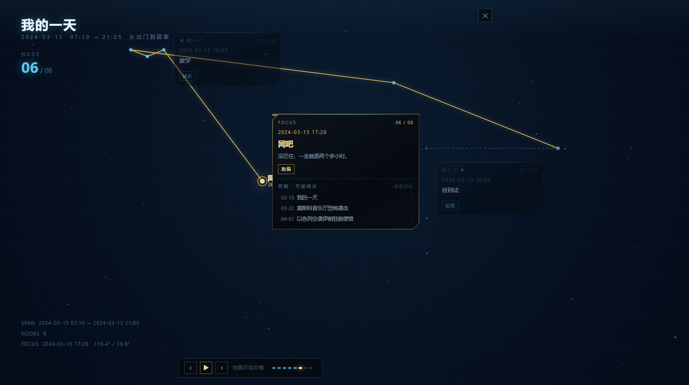

<div align="center">


# 无知编年 · CHRONICLES

**SOI 子项目之一 · 无知之海**
<sub>SEA OF IGNORANCE</sub>

[**▶ 打开演示**](demo/index.html) &nbsp;·&nbsp; [设计演进](design/README.md)

</div>

> *I am a beacon of knowledge blazing out across a black sea of ignorance.*

**时空笔记本。把历史写成你自己的结构。**

---

## 核心判断

> **时间轴和地图不是两个视图，是同一个「时空块」的两个投影。**
>
> 一个块 = **一段时间 × 一片地方**。
> 在时间轴上是条带，在地图上是色块。选中一个，另一个跟着动。

市面上已有的历史工具（Geacron、Historic Borders、Point in History）都做完了「**查**」——
它们给你一张做好的地图，你只能浏览。

**这个项目想做的是「写」**：你自己画块、自己标时间、自己记不确定的地方，
让结构**从你的记忆里长出来**，而不是从别人的数据库里查出来。

---

## 效果

### ① 时间轴 + 地图 = 同一个时空块的两个投影



演示数据是 100 件世界大事（2016–2025）。按播放，镜头会随事件飞到它所在的位置；
事件点有「成熟度」—— 刚发生的亮，过去的暗。

### ② 事件隧道：上为因，下为果



点地图上任意一个事件 → 右侧展开它的**关系隧道**。
上面是促成它的事件，下面是被它影响的事件，相连的是会流动光的能量线。

> 关系来自**评分制推断**（同地点 +4 / 标题 2-gram 重合 +4 / 同分类一年内 +3 / 时间很近 +1），
> **总分低于 3 一律不显示** —— 宁可说「没有找到明显相关的」，也不塞垃·圾进来。
> 自动推断不准时可以在数据里手写 `links`。

### ③ 叙事模式：一个事件展开成它自己的时间线



一个具体的小事（比如「我的一天」）可以展开成一条子时间线。
浮动卡片只显示 **前一个 / 当前 / 后一个**，可以拖动，位置会记住。

### ④ 尺度自适应：从十年全球，到一天一座城

同一套机制，两个完全不同的故事：

| | 大事件纪实 | 我的一天 |
|---|---|---|
| 时间跨度 | 10 年 | 14 小时 |
| 时间刻度 | 年 / 月 | 时 / 分 |
| 空间精度 | 经纬度 · ~50 km | 街道 · ~10 m |
| 地图上是 | **一条单向推进的战线** | **一个闭合的环** |

> 「生活会绕回原点，战线不会。」
> —— 这个隐喻是免费的，**地图自己会把它画出来**。

---

## 能力一览

| | |
|---|---|
| **播放** | 时间轴推进，镜头缓动跟随，事件点有成熟度 |
| **事件隧道** | 上因下果，评分制关系推断 + 手工 `links` |
| **叙事模式** | 事件展开成子时间线，浮动卡片可拖，同期事件可对比 |
| **图层** | 「世界」和「我」分开看，个人记录不会被大事淹没 |
| **个人记录** | 颗粒度到分钟，地图上画出闭环 |
| **导入导出** | 一行 JSON 加数据；单条也能用表单加 |
| **尺度自适应** | 十年全球 ↔ 一天一城，同一个界面 |

---

## 怎么跑

### 网页版（推荐，零依赖）

```bash
# 最简：直接双击
demo/index.html

# 想改代码建议起个本地服务
cd demo
python -m http.server 8765
# → http://localhost:8765
```

> **为什么建议起服务？**
> 双击走 `file://`，浏览器会隐藏跨源脚本的报错，出问题只显示一句 `Script error.`。
> 起本地服务后报错完整可见 —— **这个坑踩过一次**，记在这里。

**零依赖、零构建。** 没有 npm、没有打包器，就是 HTML + CSS + 原生 JS。
十年后还能打开 —— 不会因为某个包消失就跑不起来。

**调试入口：**

| 参数 | 作用 |
|---|---|
| `?diag=1` | 把关键元素的实际尺寸打进 `<title>`（排查布局问题的神器） |
| `?t=2025-06` | 跳到某个时刻 |
| `?layer=world\|mine\|all` | 切图层 |
| `?story=AI&node=5` | 直接展开某条叙事 |
| `?tunnel=俄乌` | 直接打开某个事件的隧道 |

### 桌面版（Tauri + React）

需要 [Rust](https://www.rust-lang.org/learn/get-started) 与 [Tauri 前置](https://v2.tauri.app/start/prerequisites/)。

```bash
npm install
npm run dev          # 浏览器：http://localhost:1420/
npm run tauri:dev    # 桌面窗口
```

**地图图源：**
- 优先本地瓦片：放到 `public/tiles/{z}/{x}/{y}.png`，并把 `public/tiles/meta.json` 的 `"ready"` 改成 `true`
- 否则回退高德在线瓦片（国内可访问）
- 大体积瓦片已在 `.gitignore`，**不要提交**

---

## 目录

```
chronicles/
├── demo/                  ★ 可直接运行的网页版（零依赖、零构建）
│   ├── index.html
│   ├── css/app.css
│   ├── js/                core · focus · tunnel · add · boot
│   ├── assets/            SOI logo
│   ├── events.js          演示数据（100 件世界大事 + 我的一天）
│   └── world.js           世界轮廓（简化后 45 KB）
├── src/  src-tauri/       Tauri 桌面版（React + TS）
├── design/                设计演进 v1 → v6（每阶段一张代表作 + 说明）
├── docs/                  README 用的截图
└── data/                  历史疆域 GeoJSON（18.7 MB，不入库）
```

**`demo/` 拆成 5 个 JS 文件**（`core / focus / tunnel / add / boot`），
都是普通 `<script>`，共享同一个全局作用域 —— **加载顺序不能乱**。

---

## 待办

- [ ] 主时间轴可缩放（年 → 月 → 日 → 时）
- [ ] 拍照 → 读 EXIF 坐标 → 自动生成轨迹（个人记录的录入入口）
- [ ] IndexedDB 持久化（现在刷新就没了）
- [ ] 分享单条叙事为自包含 HTML
- [ ] 隧道改成「水面」形式：上面是因，下面是果的倒影

---

<div align="center"><sub>春日号 · 无知编年 CHRONICLES · 深海回声 ECHOES</sub></div>
